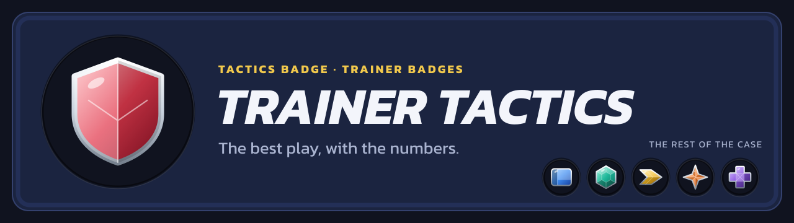
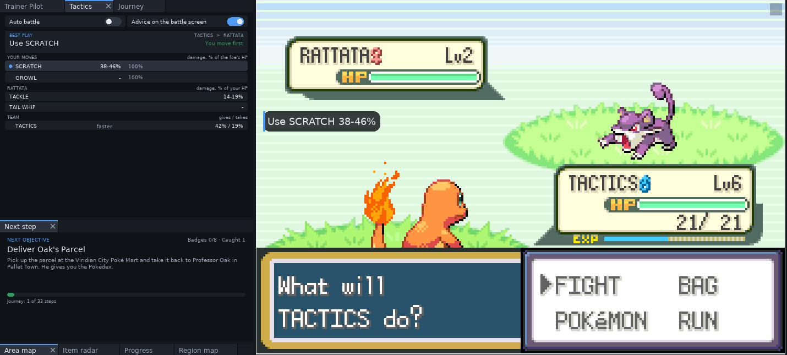
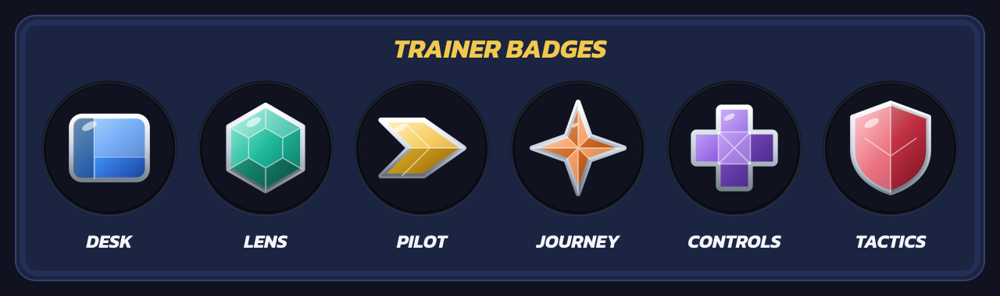

# Trainer Tactics

A battle brain for Pokémon FireRed/LeafGreen on Gen1Recomp (mod API 3). It works out the best play of each turn and either shows it to you or plays it.



## What it does

- **Advisor** (on by default): while you choose, a small box on the battle screen names the best play and the damage of your attacks. The **Tactics** panel in Trainer Desk shows the whole picture:
  - your moves: damage as a range in % of the foe's HP, accuracy, and notes (KO, may KO, no effect, two turns, may miss...);
  - the foe's moves: damage in % of your HP, in red when one can knock you out;
  - your team: what each one would give and take against this foe, faster or slower, and whether coming in is risky.
- **Auto battle** (off by default): Tactics plays the battle through the game's own menus.
  - Attacks with the best move; a sure knock-out comes first, the most accurate one among them.
  - Uses sleep, paralysis, poison, burns, set-up and healing moves when they pay off.
  - Switches out when the one out is about to fall or cannot hurt and a team mate is clearly better; chooses who comes in after a faint; answers "Will you switch your Pokémon?".
  - Leaves to you: learning a move, nicknames, evolution, items, running from wild Pokémon.
- **Foe moves** option: KNOWN reads the foe's real moves; GUESSED assumes one plain attack of each of its types.

## How it decides

Damage comes from the game's own damage function, with the lowest and highest roll and no critical hit, so stats, stat stages, types, STAB, weather and screens count as they do in the game. On top of that: abilities that soak up a type (Levitate, Volt Absorb, Water Absorb, Flash Fire, Wonder Guard), multi-hit moves, accuracy, priority and speed. See [docs/ARCHITECTURE.md](docs/ARCHITECTURE.md) for the scoring.

## Turning things on and off

- The two switches at the top of the Tactics panel.
- The mod options **Auto battle** and **Advice on the battle screen**.
- With Trainer Controls: bind "Tactics: auto battle on/off" and "Tactics: advice on/off" to a key or button.

## With the other Trainer mods

| Mod | What happens |
| --- | --- |
| Trainer Desk | The Tactics panel. |
| Trainer Pilot (0.30.0+) | The bot's battles pick their move with this brain, asked for speed (attacks first). While the bot runs, auto battle stands aside. |
| Trainer Controls | Two actions to bind. |

None of them is needed.

## Compatibility

| | |
| --- | --- |
| Games | FireRed and LeafGreen |
| Gen1Recomp | 0.3.93 or newer (mod API 3); tested on 0.4.8 |

## Installation

Copy the `trainer_tactics` folder into `%APPDATA%\pokemon-love2d\mods`.

## Options

| Option | Default | What it does |
| --- | --- | --- |
| Language | English | ENGLISH, ESPANOL, PORTUGUES or JAPANESE. |
| Auto battle | Off | Tactics plays your battles. |
| Advice on the battle screen | On | The small box while you choose. |
| Foe moves | Known | KNOWN or GUESSED. |

## Known limits

- It looks one turn ahead. It does not plan sequences or predict switches.
- It never uses items; when HP is low it says healing may be worth it.
- Double battles: each of your Pokémon chooses against the first foe, and there is no switching.
- Critical hits, secondary effects (flinch, stat drops) and held items of the foe are not weighed beyond what the damage function does.
- Safari Zone battles are left alone.

## For other mods

```lua
local other = mod.find("trainer_tactics")
local api = other and other.exports and other.exports.tactics
if api and api.api == 1 then
  local slot = api.bestMove({ fast = true, ban = function(mon, moveId) return false end })
end
```

`evaluate(opts)` returns the whole advice; `shift{ foeMon }` and `bestSwitch{}` return a team mate or nil.

## Documentation

[docs/GUIDE.md](docs/GUIDE.md) · [docs/ARCHITECTURE.md](docs/ARCHITECTURE.md) · [docs/TRANSLATING.md](docs/TRANSLATING.md) · [docs/PUBLISHING.md](docs/PUBLISHING.md) · [CHANGELOG.md](CHANGELOG.md)

## The Trainer Badges

Six mods for FireRed and LeafGreen that work on their own and better together. Each one is a badge in the same case.



| | Mod | What it does |
| --- | --- | --- |
|  | [Trainer Desk](https://github.com/MarcoAFSchaefer/trainer-desk) | Docks and tabs around the game. |
|  | [Trainer Lens](https://github.com/MarcoAFSchaefer/trainer-lens) | Everything the game knows, on screen. |
|  | [Trainer Pilot](https://github.com/MarcoAFSchaefer/trainer-pilot) | Trains and hunts while you are away. |
|  | [Trainer Journey](https://github.com/MarcoAFSchaefer/trainer-journey) | Where to go next, without spoilers. |
|  | [Trainer Controls](https://github.com/MarcoAFSchaefer/trainer-controls) | Every button, where you want it. |
|  | **Trainer Tactics** (this mod) | The best play, with the numbers. |

## What it changes in the game

[DIFFERENCES.md](DIFFERENCES.md) lists everything this mod does differently from the unmodded game.

## License

MIT. The bundled font is under the SIL Open Font License (`trainer_tactics/fonts/OFL.txt`).
